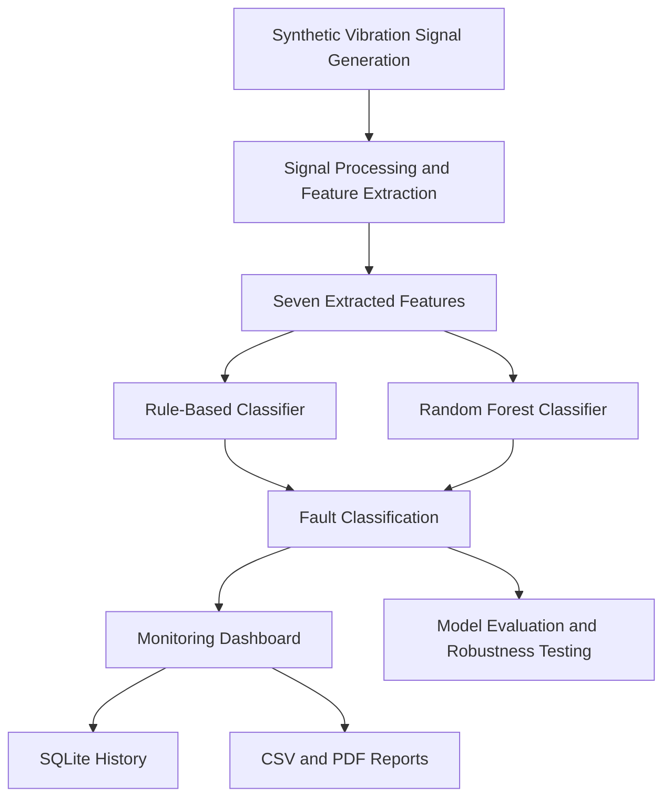
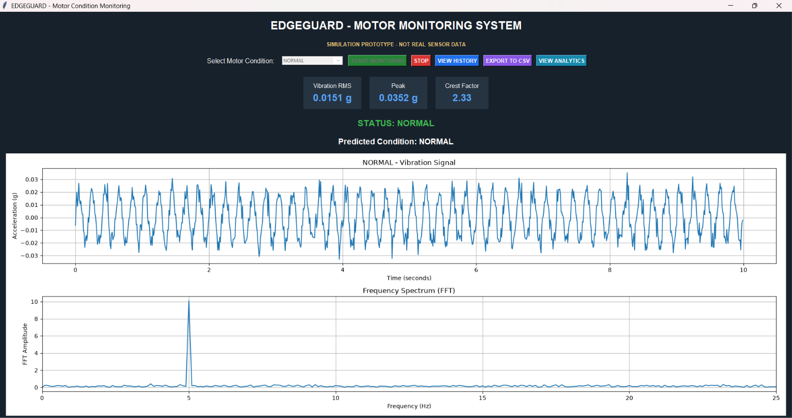
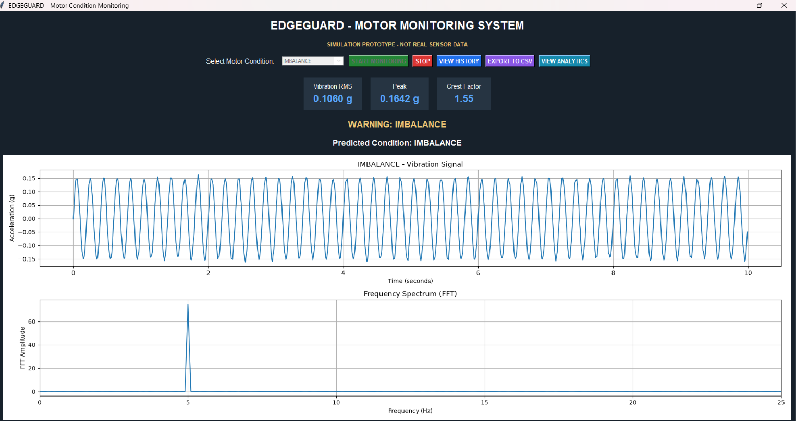
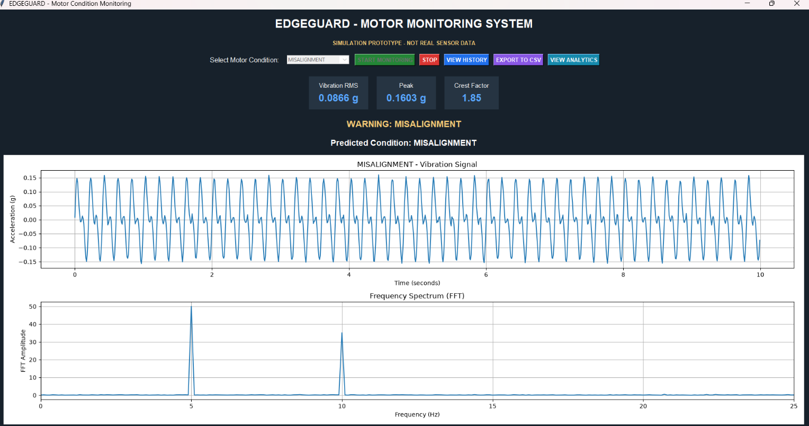
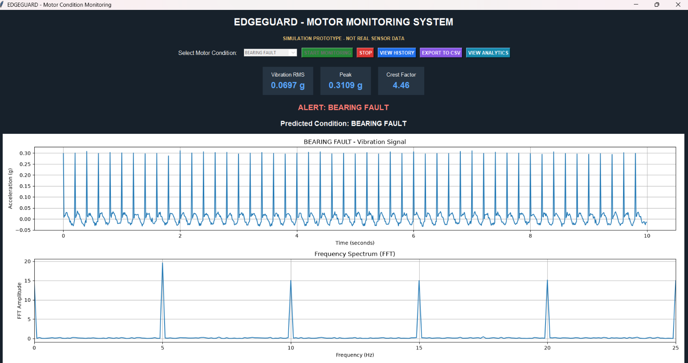
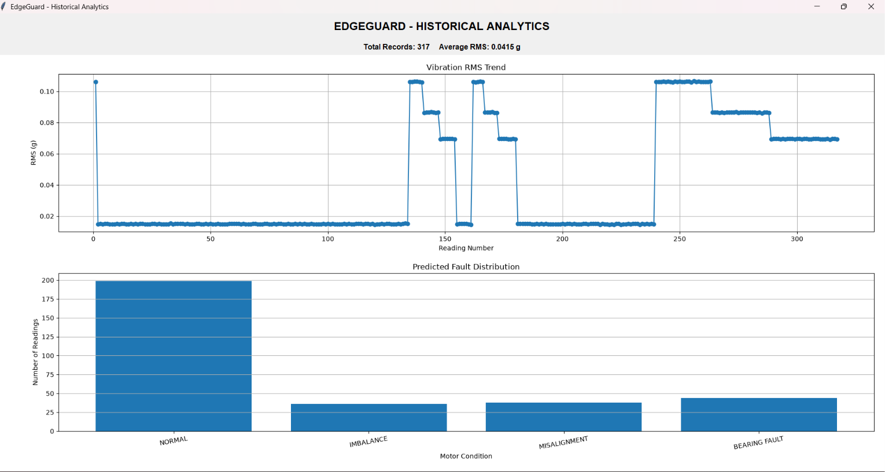
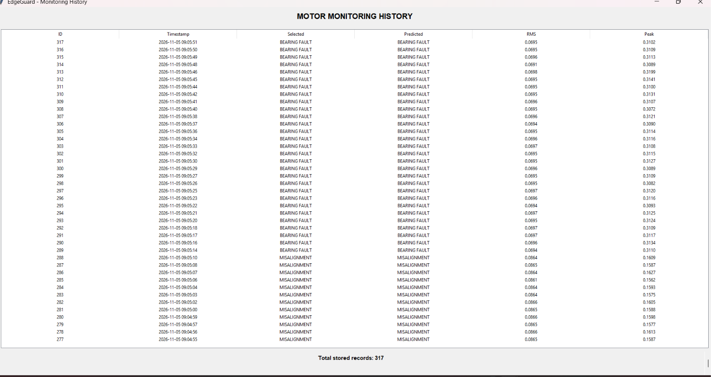
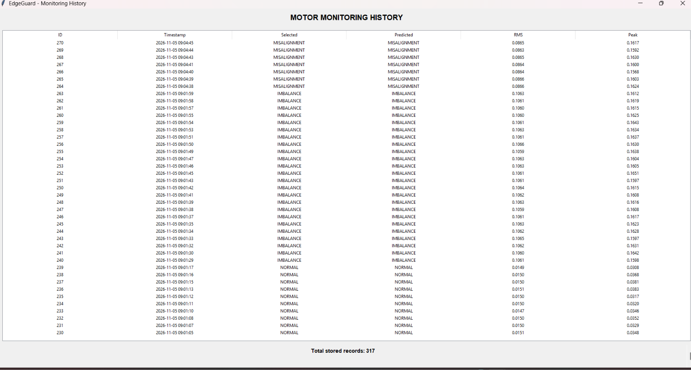

# EdgeGuard – Motor Fault Detection and Monitoring System


**EdgeGuard** is a Python-based motor fault detection and monitoring system that analyzes vibration signals to identify four operating conditions: Normal, Imbalance, Misalignment, and Bearing Fault.

The project combines signal processing, rule-based fault classification, machine learning, robustness evaluation, interactive monitoring dashboards, and automated testing.

> **Note:** This project currently uses simulated motor vibration signals. Results are experimental and have not been validated using measurements from physical motors.

## Key Features

- Synthetic motor vibration signal generation.
- Statistical and frequency-domain feature extraction.
- Rule-based fault classification.
- Random Forest machine learning classifier.
- Seven vibration features for machine learning.
- Five-fold stratified cross-validation.
- Feature importance analysis.
- Noise and amplitude variation robustness testing.
- Interactive motor monitoring dashboard.
- SQLite-based monitoring history.
- CSV and PDF report generation.
- Automated testing using Pytest.
- GitHub Actions continuous integration.

## System Architecture



### Processing Pipeline

1. **Signal Generation:** Generates vibration signals representing four motor conditions.
2. **Feature Extraction:** Calculates statistical and frequency-domain characteristics.
3. **Classification:** Applies rule-based thresholds and a Random Forest model.
4. **Evaluation:** Measures classification performance and tests robustness under varying noise and amplitude conditions.
5. **Monitoring:** Displays motor condition results through an interactive dashboard.
6. **Reporting:** Stores monitoring history and exports results into CSV and PDF formats.

## Fault Conditions

| Condition | Description |
|---|---|
| Normal | Motor operating under normal simulated conditions |
| Imbalance | Simulated vibration caused by uneven mass distribution |
| Misalignment | Simulated vibration caused by shaft misalignment |
| Bearing Fault | Simulated impact-like vibration patterns |

## Classification Methods

### 1. Rule-Based Classifier

Uses predefined thresholds derived from simulated vibration characteristics.

Features used:

- RMS
- Peak Amplitude
- Crest Factor
- Harmonic Ratio

The classifier applies threshold-based conditions to distinguish between the four motor operating conditions.

### 2. Random Forest Classifier

Uses seven extracted features:

1. RMS
2. Peak Amplitude
3. Standard Deviation
4. Crest Factor
5. Harmonic Ratio
6. Fundamental Frequency Amplitude (1×)
7. Harmonic Frequency Amplitude (2×)

**Model configuration:**

| Parameter | Configuration |
|---|---|
| Algorithm | Random Forest |
| Number of estimators | 200 |
| Training/testing split | 80:20 |
| Data splitting | Stratified |
| Random state | 42 |
| Class weighting | Balanced |
| Cross-validation | 5-fold Stratified |

## Dataset and Model Evaluation

EdgeGuard evaluates both rule-based and Random Forest classifiers using synthetic motor vibration signals representing four operating conditions.

### Baseline Dataset

The baseline dataset contains 800 samples:

- 200 samples per motor condition.
- 640 training samples (80%).
- 160 testing samples (20%).
- Seven statistical and frequency-domain features per sample.
- Stratified data splitting with a fixed random state.

### Baseline Model Performance

| Metric | Rule-Based Classifier | Random Forest |
|---|---:|---:|
| Accuracy | 100.00% | 100.00% |
| Macro Precision | 100.00% | 100.00% |
| Macro Recall | 100.00% | 100.00% |
| Macro F1-score | 100.00% | 100.00% |

### Random Forest Cross-Validation

Five-fold stratified cross-validation produced:

- Mean accuracy: **100.00%**
- Standard deviation: **0.00%**

### Noisy Stress Test

Both classifiers were evaluated on the same 400 noisy test signals, using additional noise with a standard deviation of 0.02 and amplitude scaling between 0.8× and 1.2×.

| Metric | Rule-Based Classifier | Random Forest |
|---|---:|---:|
| Accuracy | 100.00% | 96.25% |
| Macro Precision | 100.00% | 96.74% |
| Macro Recall | 100.00% | 96.25% |
| Macro F1-score | 100.00% | 96.23% |

The Random Forest showed reduced accuracy under this noisy test, primarily due to confusion between the Imbalance and Misalignment classes.

### Robustness Evaluation

A separate robustness experiment used a varied training dataset containing 1,200 samples and evaluated both classifiers under nine amplitude and noise combinations.

- Amplitude scaling: 0.8×, 1.0× and 1.2×.
- Noise standard deviation: 0.005, 0.02 and 0.04.
- 120 test signals per amplitude/noise combination.
- 1,080 test signals in total.

| Amplitude | Noise Std. Dev. | Rule-Based Accuracy | Random Forest Accuracy |
|---|---:|---:|---:|
| 0.8× | 0.005 | 95.00% | 100.00% |
| 0.8× | 0.02 | 100.00% | 100.00% |
| 0.8× | 0.04 | 93.33% | 100.00% |
| 1.0× | 0.005 | 100.00% | 100.00% |
| 1.0× | 0.02 | 100.00% | 100.00% |
| 1.0× | 0.04 | 85.00% | 100.00% |
| 1.2× | 0.005 | 100.00% | 100.00% |
| 1.2× | 0.02 | 100.00% | 100.00% |
| 1.2× | 0.04 | 84.17% | 100.00% |

Average accuracy across the nine conditions:

- Rule-Based Classifier: **95.28%**
- Random Forest: **100.00%**

### Interpretation and Limitations

The baseline results indicate that both classifiers can distinguish the four simulated fault classes under the generated signal conditions. The noisy stress test and robustness experiment demonstrate how their performance changes under different noise and amplitude settings.

The perfect baseline and robustness scores should be interpreted cautiously. The synthetic classes are relatively well-separated by the features and patterns used during data generation. These results do not establish equivalent accuracy on real industrial motors.

All experiments use synthetic vibration data. Validation using real motor sensor measurements, different operating speeds, loads and physical fault conditions is required before practical deployment.

### Generated Evaluation Files

- `model_comparison.csv`
- `cross_validation_results.csv`
- `stress_test_results.csv`
- `robustness_results.csv`
- `ml_confusion_matrix.png`
- `feature_importance.png`
- `stress_confusion_matrix.png`
- `stress_rule_confusion_matrix.png`
- `stress_test_comparison.png`
- `robustness_comparison.png`

## Application Screenshots

### Motor Condition Detection

**Normal Condition**



**Imbalance Detection**



**Misalignment Detection**



**Bearing Fault Detection**



### Monitoring Dashboard and History

**Analytics Dashboard**



**Monitoring History**



**Detailed History Records**



## Technology Stack

| Technology | Purpose |
|---|---|
| Python | Core application |
| NumPy | Signal generation and numerical calculations |
| Matplotlib | Signal plots and evaluation charts |
| Scikit-learn | Random Forest and model evaluation |
| SQLite | Monitoring history storage |
| Tkinter | Desktop dashboard interface |
| ReportLab | PDF report generation |
| Pytest | Automated testing |
| GitHub Actions | Continuous integration |

## Installation and Setup

### Prerequisites

- Python 3.12
- Git

### 1. Clone the repository

```bash
git clone https://github.com/Sharonhoney05/EdgeGuard.git
```

### 2. Navigate to the project directory

```bash
cd EdgeGuard
```

### 3. Install dependencies

```bash
python -m pip install -r requirements.txt
```

## Running the Project

**Run the integrated monitoring dashboard:**

```bash
python edgeguard_integrated_dashboard.py
```

**Run the Random Forest machine learning evaluation:**

```bash
python edgeguard_ml_classifier.py
```

**Run the rule-based classifier evaluation:**

```bash
python classifier_evaluation.py
```

**Run the robustness evaluation:**

```bash
python edgeguard_robustness_test.py
```

## Automated Testing

EdgeGuard uses Pytest for automated testing.

Run the test suite:

```bash
python -m pytest test_edgeguard.py -q
```

## Continuous Integration

GitHub Actions automatically executes the automated test suite:

- On pushes to the `main` branch.
- On pull requests targeting the `main` branch.
- Using Ubuntu and Python 3.12.

[View GitHub Actions](https://github.com/Sharonhoney05/EdgeGuard/actions)

## Project Structure

```text
EdgeGuard/
│
├── .github/
│   └── workflows/
│       └── tests.yml
│
├── screenshots/
│   ├── analytics.png
│   ├── bearing_fault.png
│   ├── imbalance.png
│   ├── misalignment.png
│   ├── normal.png
│   ├── view_history.png
│   └── view_history_details.png
│
├── classifier_evaluation.py
├── edgeguard_dashboard.py
├── edgeguard_database.py
├── edgeguard_export.py
├── edgeguard_integrated_dashboard.py
├── edgeguard_ml_classifier.py
├── edgeguard_pdf_report.py
├── edgeguard_robustness_test.py
├── fault_classifier.py
├── fault_visualization.py
├── motor_fault_simulator.py
├── requirements.txt
└── test_edgeguard.py
```

Additional evaluation outputs, reports, charts, and CSV files are generated when the corresponding scripts are executed.

## Limitations and Future Improvements

### Current Limitations

- Uses simulated vibration signals rather than real motor sensor measurements.
- Rule-based thresholds are specific to the simulated signal patterns.
- Model performance on synthetic data does not establish real-world reliability.
- Real industrial deployment would require validation with actual motor vibration datasets.

### Future Improvements

- Validate the system using real motor vibration datasets.
- Improve classification between similar fault conditions.
- Explore additional signal-processing and machine learning features.
- Evaluate performance across different motor speeds and loads.
- Integrate physical vibration sensors for real-time monitoring.

## Author

**F K Sharon**
Electronics and Communication Engineering
BITM Ballari | 2027

**Project:** EdgeGuard – Motor Fault Detection and Monitoring System

[GitHub Repository](https://github.com/Sharonhoney05/EdgeGuard)
