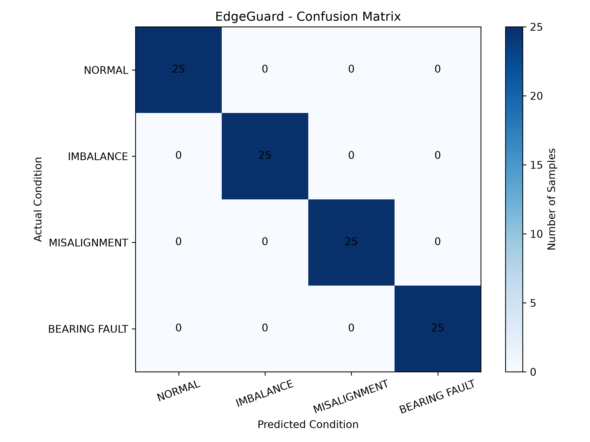

EdgeGuard - Motor Condition Monitoring and Fault Detection System

A Python-based simulation prototype for vibration analysis, motor fault classification, and predictive maintenance monitoring.

Overview

EdgeGuard is an academic engineering project that simulates motor operating conditions and analyzes vibration signals to identify potential motor faults.

It combines signal processing, statistical feature extraction, rule-based fault classification, SQLite database management, interactive visualization, automated evaluation, and PDF reporting in one application.

Project status: Simulation-based prototype. The current implementation uses generated vibration signals and is not connected to physical motor sensors.

Key Features

* Motor Fault Simulation: Generates vibration signals for normal, imbalance, misalignment, and bearing fault conditions.
* Vibration Feature Extraction: Calculates RMS, peak amplitude, standard deviation, crest factor, and harmonic ratio.
* Rule-Based Fault Classification: Uses signal features and threshold-based decision rules to classify simulated motor conditions.
* Classifier Evaluation: Evaluates predictions across 100 synthetic test samples and generates a confusion matrix and classification metrics.
* Interactive Dashboard: Displays simulated readings and motor condition status using Tkinter.
* Monitoring History: Stores and retrieves monitoring records using SQLite.
* Data Visualization: Displays vibration trends and classification analytics using Matplotlib.
* CSV Export: Exports monitoring records for further analysis.
* PDF Reporting: Generates reports containing monitoring statistics, fault distribution, historical analysis, and detailed records.
* Automated Testing: Includes tests for major project components.

Technologies Used

Technology| Purpose
Python| Core application
NumPy| Numerical and vibration calculations
Tkinter| Graphical user interface
Matplotlib| Data visualization and evaluation plots
SQLite| Monitoring data storage
ReportLab| PDF report generation
CSV| Data export and evaluation results
unittest| Automated testing

EdgeGuard/
|
|-- Day1/
|   |-- vibration_basics.py
|
|-- screenshots/
|   |-- normal.png
|   |-- bearing_fault.png
|   |-- imbalance.png
|   |-- misalignment.png
|   |-- view_history.png
|   |-- view_history_details.png
|   |-- analytics.png
|
|-- motor_fault_simulator.py
|-- fault_classifier.py
|-- classifier_evaluation.py
|-- fault_visualization.py
|-- edgeguard_database.py
|-- edgeguard_export.py
|-- edgeguard_dashboard.py
|-- edgeguard_integrated_dashboard.py
|-- edgeguard_pdf_report.py
|-- test_edgeguard.py
|-- evaluation_results.csv
|-- confusion_matrix.png
|-- README.md
|-- .gitignore

System Architecture

1. Signal Generation: The motor fault simulator generates vibration signals for four operating conditions.
2. Feature Extraction: Statistical and frequency-domain features are extracted from each vibration signal.
3. Fault Classification: A rule-based classifier analyzes the extracted features and predicts the motor condition.
4. Evaluation: The classifier is evaluated using synthetic test samples. Accuracy, precision, recall, F1-score, and a confusion matrix are generated.
5. Database Management: SQLite stores monitoring readings and calculated features.
6. Dashboard: The integrated dashboard displays readings, graphs, and motor condition information.
7. Reporting: Users can view historical records, export CSV data, and generate PDF reports.

Fault Classification Methodology

EdgeGuard currently uses a threshold-based rule classifier.

The classifier evaluates the following features:

* RMS: Measures the overall vibration level.
* Peak amplitude: Measures the maximum absolute vibration amplitude.
* Crest factor: Ratio of peak amplitude to RMS.
* Harmonic ratio: Compares the 10 Hz harmonic magnitude with the 5 Hz fundamental magnitude.

The current decision rules are:

Condition| Classification Rule
Bearing Fault| Peak amplitude > 0.25 and crest factor > 2.5
Misalignment| Harmonic ratio > 0.4
Imbalance| RMS > 0.05
Normal| None of the above conditions are met

These thresholds were selected for the current simulated signal patterns. They are experimental project parameters, not universal industrial diagnostic limits.

Classifier Evaluation

The evaluation module tests the rule-based classifier using 100 synthetic vibration samples:

* 25 Normal samples
* 25 Imbalance samples
* 25 Misalignment samples
* 25 Bearing Fault samples

The evaluation generates:

* Accuracy
* Per-class precision
* Per-class recall
* Per-class F1-score
* Confusion matrix
* CSV evaluation results

Current Synthetic Evaluation Results

Metric| Result
Test samples| 100
Correct predictions| 100
Incorrect predictions| 0
Accuracy| 100%
Macro precision| 100%
Macro recall| 100%
Macro F1-score| 100%

Confusion Matrix

Important evaluation limitation: These results are based entirely on synthetic signals generated by the project's own simulator. The classifier and evaluation use the same simulated signal patterns, so the results demonstrate performance on the current synthetic test cases only. They do not establish real-world motor fault detection accuracy or industrial reliability.

Installation and Setup

1. Clone the repository

git clone https://github.com/Sharonhoney05/EdgeGuard.git

2. Navigate to the project directory

cd EdgeGuard

3. Install dependencies

pip install numpy matplotlib reportlab

Tkinter and SQLite are included with most standard Python installations.

4. Launch the integrated dashboard

python edgeguard_integrated_dashboard.py

5. Run classifier evaluation

python classifier_evaluation.py

This generates "evaluation_results.csv" and "confusion_matrix.png".

6. Run automated tests

python -m unittest test_edgeguard.py -v

Applications:

* Motor condition monitoring concepts
* Vibration-based fault detection
* Predictive maintenance
* Industrial automation
* Industrial IoT applications
* Equipment health monitoring

Future Enhancements

* Evaluation using publicly available real vibration datasets.
* Machine learning-based fault classification.
* Comparison between rule-based and machine learning models.
* Integration with physical vibration sensors.
* ESP32-based wireless motor monitoring.
* Cloud-based monitoring and analytics.
* Real-time abnormal-condition alerts.

Testing

The project includes automated tests covering simulation, vibration calculations, fault classification, classifier evaluation, database operations, data export, dashboard functionality, and report generation.

Latest verified test result: 27 tests passed.

Author

F K Sharon
Electronics and Communication Engineering

Project Disclaimer

EdgeGuard is an academic simulation-based prototype developed to explore motor condition monitoring, vibration analysis, and software-based fault detection. Its simulated results should not be interpreted as real industrial measurements or validated diagnostic performance.

