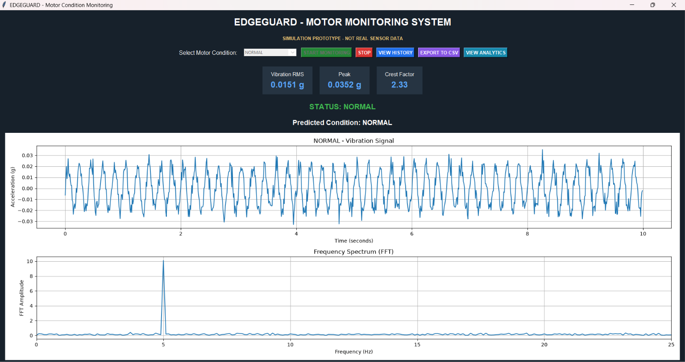
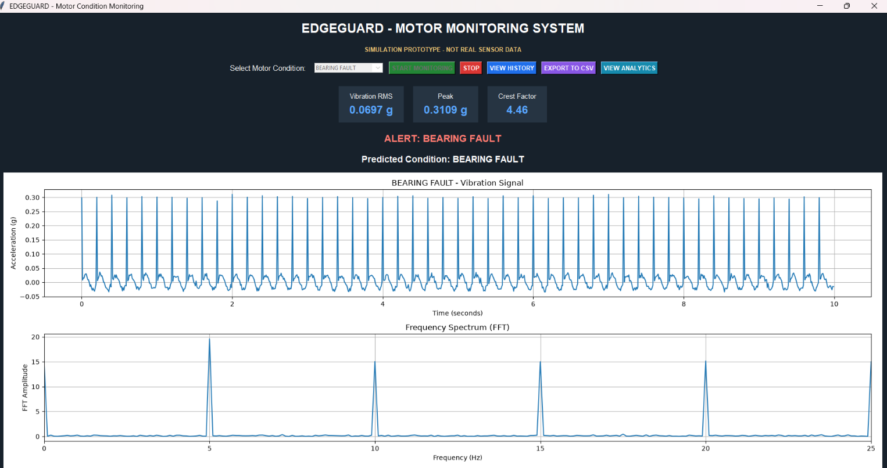
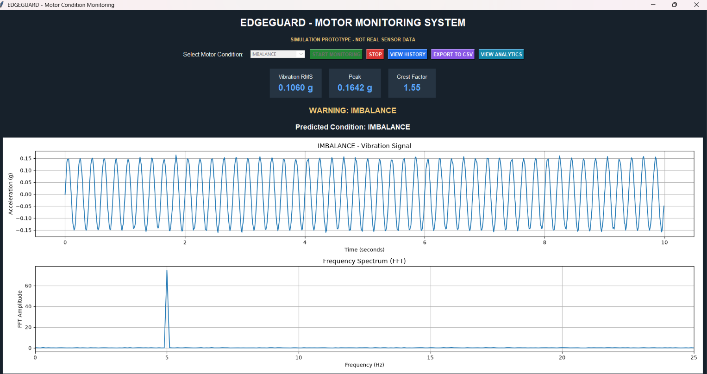
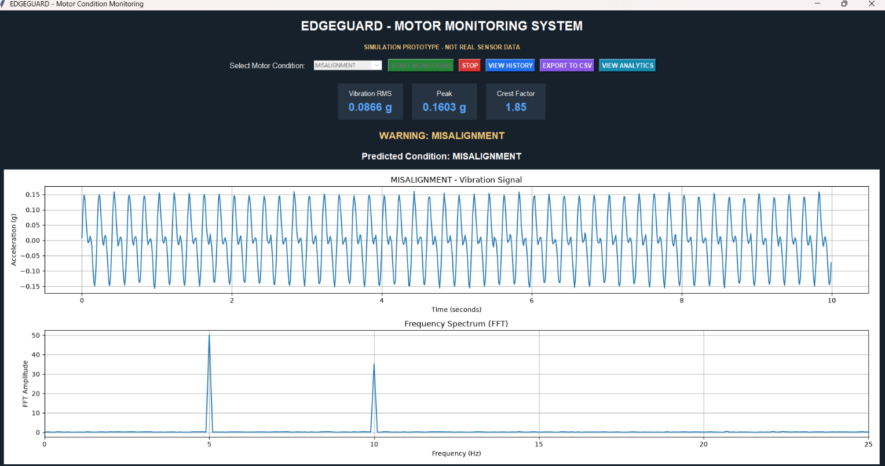
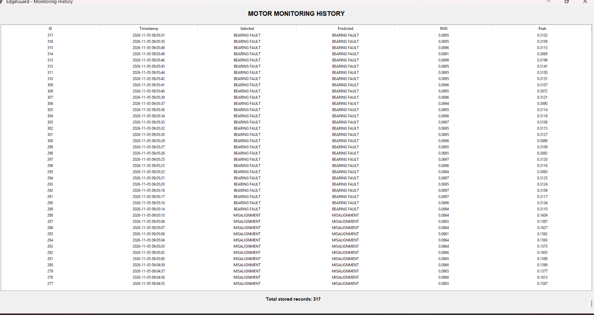
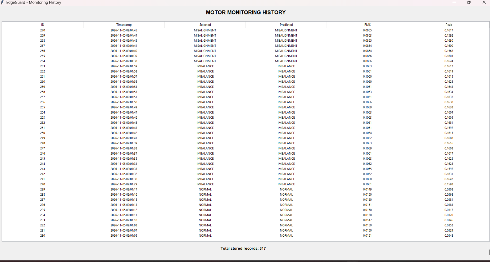
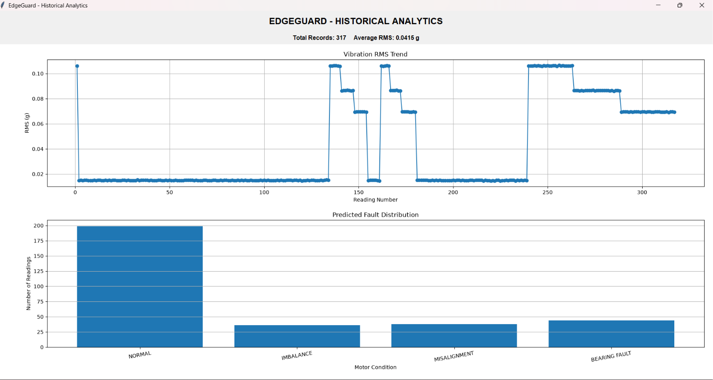

EdgeGuard – Motor Condition Monitoring and Fault Detection System

Overview

EdgeGuard is a Python-based motor condition monitoring and fault detection system designed to simulate motor operating conditions, analyze vibration data, identify potential faults, and monitor system performance through an integrated graphical dashboard.

The project combines data simulation, feature extraction, fault classification, database management, and visualization to demonstrate a software-based approach to predictive maintenance.

Key Features

- Motor Data Simulation: Generates sample motor monitoring data.
- Vibration Analysis: Extracts relevant statistical features from vibration signals.
- Fault Classification: Identifies potential motor conditions using a classification module.
- Database Management: Stores monitoring information using SQLite.
- Interactive Dashboard: Displays monitoring information through a Tkinter GUI.
- Data Visualization: Uses Matplotlib to visualize monitoring results.
- PDF Reporting: Generates a motor monitoring report.

Technologies Used

- Python
- NumPy
- Tkinter
- Matplotlib
- SQLite
- CSV
- PDF

Project Structure

EdgeGuard/
│
├── Day1/
│   └── vibration_basics.py
│
├── motor_fault_simulator.py
├── fault_classifier.py
├── classifier_evaluation.py
├── fault_visualization.py
├── edgeguard_database.py
├── edgeguard_export.py
├── edgeguard_dashboard.py
├── edgeguard_integrated_dashboard.py
├── edgeguard_pdf_report.py
├── test_edgeguard.py
│
├── edgeguard.db
├── edgeguard_monitoring_report.csv
├── EdgeGuard_Monitoring_Report.pdf
├── README.md
└── .gitignore

System Architecture

1. Motor data is generated using the simulation module.
2. Vibration features are extracted from the generated data.
3. The classification module analyzes the extracted features.
4. Monitoring information is stored in the SQLite database.
5. The integrated dashboard displays monitoring information and visualizations.
6. A PDF report provides a record of the monitoring results.

Installation and Setup

1. Clone the Repository

git clone https://github.com/Sharonhoney05/EdgeGuard.git

2. Navigate to the Project Directory

cd EdgeGuard

3. Install Dependencies

pip install numpy matplotlib

4. Run the Application

python edgeguard_integrated_dashboard.py

## Screenshots

### Motor Fault Classification

The system visualizes four motor operating conditions:

#### 1. Normal Condition

#### 2. Bearing Fault

#### 3. Imbalance

#### 4. Misalignment

### Monitoring History

#### Historical Monitoring Records

#### Detailed Monitoring History

### Analytics Dashboard

Applications

- Industrial motor condition monitoring
- Predictive maintenance concepts
- Vibration-based fault detection
- Industrial IoT and automation
- Equipment health monitoring

Future Enhancements

- Integration with real-time vibration sensors.
- ESP32-based wireless motor monitoring.
- Machine learning-based fault classification.
- Cloud-based monitoring and analytics.
- Real-time alerts for abnormal motor conditions.

Author

F K Sharon

Electronics and Communication Engineering

Project Note

EdgeGuard is an academic engineering project developed to explore motor condition monitoring, vibration analysis, and software-based fault detection.